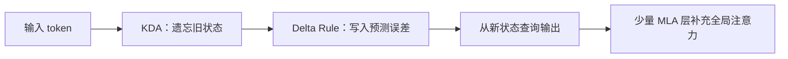

# Kimi Linear：论文阅读笔记与复现实验

围绕 **Kimi Linear: An Expressive, Efficient Attention Architecture**，整理 Mira 研究报告、图解 HTML、论文机制与复现路径。

> 本仓库是个人学习与实验记录。原始资料、论文报告值、本仓库实际运行结果分别标注；不是 Moonshot 官方实现。

**论文**：[arXiv:2510.26692](https://arxiv.org/abs/2510.26692) · **官方入口**：[MoonshotAI/Kimi-Linear](https://github.com/MoonshotAI/Kimi-Linear) · **整理日期**：2026-10-13

## 从这里开始

| 想做什么 | 阅读入口 |
|---|---|
| 理解问题、公式和模型结构 | [论文阅读笔记](notes/paper-reading.md) |
| 看原图和已有实验讲解 | [HTML 报告的 Markdown 版](materials/html-report.md) |
| 阅读完整领域调研 | [Mira 研究报告](materials/original/mira-research-report.md) / [PDF](materials/original/mira-research-report.pdf) |
| 避免误读数字和代码 | [勘误与证据边界](notes/corrections.md) |
| 动手复现 | [实验指南](experiments/README.md) |
| 查原始来源与版本差异 | [一手来源核验](notes/sources.md) |

## 核心理解

KDA（Kimi Delta Attention）把 Gated DeltaNet 的每头标量遗忘门，细化为每个 key 通道独立的遗忘门；先衰减旧状态，再写入预测误差。Kimi Linear 通过 KDA 与 MLA（多头潜变量全注意力）按层混合，兼顾固定状态的效率和全局检索能力。



论文的主要混合规律是 **3 KDA : 1 MLA**。实际公开 48B 模型为 **27 层：20 KDA + 7 MLA**，末层也是 MLA。因此，完整混合模型仍有随上下文增长的 KV 缓存，不能称作纯线性模型。[配置快照](materials/official-model-config.json) · [原始配置](https://huggingface.co/moonshotai/Kimi-Linear-48B-A3B-Instruct/blob/main/config.json)

## 复现状态

| 内容 | 状态 | 证据 |
|---|---|---|
| 原始 HTML、15 张内嵌图与4个代码片段 | 已归档 | [材料清单](materials/README.md)、[哈希清单](materials/manifest.json) |
| Mira 研究报告 Markdown 与10页 PDF | 已归档 | [更新后的分享](https://mira.deepprinciple.com/share/sessions/E3CW47cG) |
| 教学递推与分块算子 | 已补全并验证 | [实现](experiments/kda_reference.py)、8项测试 |
| 数值等价性 | 本仓库实测120组 | [JSON原始结果](results/verified-cpu.json)、[结果说明](results/README.md) |
| MQAR（多查询关联召回）训练 | 原资料报告，尚未重新运行 | [实验协议与缺失项](experiments/mqar-protocol.md) |
| GPU 算子速度、48B质量、SFT/RL | 本仓库未运行 | [分级复现指南](experiments/README.md) |

本地实测环境：Windows / Python 3.12.10 / PyTorch 2.13.0+cpu，CPU使用2线程。120组对照的最大输出绝对误差：float64 **1.554×10⁻¹⁵**，float32 **7.153×10⁻⁷**。这些结果验证教学算子的数值一致性，不验证论文的 GPU 吞吐或模型质量。

## 快速运行

在仓库根目录执行；安装依赖后不需要网络或 GPU。

```bash
python -m venv .venv
# Windows PowerShell：.venv\Scripts\Activate.ps1
# Linux/macOS：source .venv/bin/activate
python -m pip install -r requirements.txt
python -m unittest discover -s tests -v
python -m experiments.run_cpu --output results/local/cpu-check.json
```

重新运行的结果默认写入忽略跟踪的 `results/local/`；已提交的 `verified-cpu.json` 是整理当天的真实记录。

## 文件结构

```text
materials/                  原始资料、转写、图片、配置与来源清单
notes/
  paper-reading.md          问题 → 公式 → 架构 → 证据 → 学习路线
  corrections.md            原资料勘误与口径校正
  sources.md                一手核验与2026后续工作
experiments/
  kda_reference.py          递推、分块教学算子
  run_cpu.py                可重复数值实验与原始JSON导出
  mqar-protocol.md           训练复现协议与待补资料
  README.md                 分级实验入口
tests/test_kda.py           更新顺序、因果性、状态、梯度等测试
results/                    本仓库实际运行结果
references.bib              核心论文引用
NOTICE.md                   材料归属与使用说明
```

原资料中提到的 `kda_core.py`、`exp1_kernel.py`、`exp3_mqar.py` 等完整脚本与历史 `results/*.json` 尚未取得。本仓库保留其报告与图表，并提供独立补全的教学算子；不把缺失脚本或历史数据伪装为已恢复。论文质量数字也应按原始实验条件引用，尤其区分1.4T公平对比与5.7T公开权重。
