> 用户 HTML 的自动转写，图表为原资料提取；历史实验数字未重新验证。请配合 [勘误与证据边界](../notes/corrections.md) 阅读。原始排版见 [HTML](original/kimi-linear-reading-reproduction.html)。

PAPER READING × REPRODUCTION

# Kimi Linear：一个能打赢全注意力的线性混合架构

精读 + 复现的学习报告 —— 读懂 KDA（Kimi Delta Attention）的「细粒度门控 + Δ 规则」， 并用 CPU 上的可运行代码把论文的关键结论一张一张画出来，与原图并排对照。

Kimi Team · Moonshot AI  arXiv:2510.26692  2025-10  开源：KDA kernel + vLLM + 权重

**3 : 1** KDA : 全注意力层间混合比

**−75%** KV cache 占用（论文上限）

**6.3×** 1M 上下文解码吞吐（TPOT）

**1.16×** 同算力损失更低（scaling law）

**~1e-15** 本次复现：分块 ≡ 循环的误差

## 00 阅读地图：这篇论文在解决什么问题？

一句话版本：**softmax 全注意力太贵，纯线性注意力又太"笨"，Kimi Linear 用「3 层 KDA + 1 层全注意力」的混合配方， 第一次在同等训练条件下全面追平并超过了全注意力**——短上下文更强、长上下文更强、KV cache 省 75%、百万级上下文解码快 6 倍。

**为什么它值得关注？** 过去所有线性注意力论文的叙事都是「我们牺牲一点点精度，换来巨大的效率提升」。这篇论文反过来了： **在 1.4T token 的严格公平对比下，它不但更快更省，还更准**（MMLU-Pro 51.0 vs 47.2，RULER 84.3 vs 81.3）。 这是「线性注意力第一次赢下全注意力」的标志性结果，所以它被称为 2026 年注意力方向最出名的论文之一。

**痛点：全注意力的两个天花板**

KV cache  随上下文线性膨胀，注意力计算随上下文二次增长——Agent 时代动辄百万 token 的输入让这两件事变得不可接受。

**旧方案：线性注意力省资源，但"记性差"**

它把注意力改写成固定大小的循环状态，代价是精确检索能力差（抄写、召回任务吃力）。

**本文方案：KDA + 3:1 混合**

KDA（Kimi Delta Attention）给线性注意力装上「细粒度遗忘门 + Δ 规则修正」两件武器， 再每隔 3 层插 1 层全注意力兜底全局检索。

**验证：从合成任务到 48B 模型**

合成任务拆解机制 → scaling law 验证可扩展性 → 1.4T/5.7T token 预训练 + SFT + RL 全流程对比。

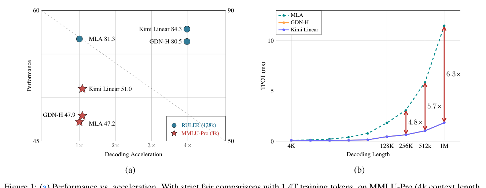

**论文 Figure 1**：左——性能 vs 解码加速（越靠右上越好）：红点=短上下文 MMLU-Pro，蓝点=长上下文 RULER， Kimi Linear 都在最右上角；右——单 token 解码时延 TPOT 随上下文长度的变化：MLA 一路走高，Kimi Linear 几乎水平（1M 时 6.3 倍）。

## 01 预备知识：读懂 KDA 只需要五个概念

每个概念配一个"人话解释"和它在本篇论文里的角色。悬停/点按文中虚线词也可随时查看解释。

#### ① 线性注意力 = 一块固定大小的"草稿本"

标准注意力每个 token 都要和之前所有 token 两两算相似度（O(T²)）。  线性注意力  换了一种记账方式：维护一个固定大小的矩阵状态 `S`，每来一个 token 就更新一次草稿本，查询时翻草稿本。 它的公式是外积累加：

S<sub>t</sub> = S<sub>t−1</sub> + k<sub>t</sub> v<sub>t</sub><sup>⊤</sup> o<sub>t</sub> = S<sub>t</sub><sup>⊤</sup> q<sub>t</sub> 线性注意力的循环形式（Katha… 2020）

**问题**：草稿本只会加不会删，写得越多越乱（互相干扰），这就是线性注意力"记性差"的根源。

#### ② Δ 规则（Delta Rule）= 写新内容前先擦掉旧的

联想记忆的经典学习规则（也是神经科学里的 Hebbian 学习的纠错版）：写入 `k→v` 之前， 先把状态里 `k` 对应位置的旧内容减掉——数学上等价于对重建损失做一步**在线梯度下降**：

S<sub>t</sub> = (I − β<sub>t</sub> k<sub>t</sub> k<sub>t</sub><sup>⊤</sup>) S<sub>t−1</sub> + β<sub>t</sub> k<sub>t</sub> v<sub>t</sub><sup>⊤</sup> DeltaNet（Schmidhuber 1992 / Yang et al. 2024）

其中  β<sub>t</sub>（写入强度）  是数据相关的标量。秩一项 k k<sup>⊤</sup> 在几何上是一次  Householder 反射 ， 这保证了整串更新可以被高效并行（后面 §2 讲怎么做）。

#### ③ 遗忘门 α = 草稿本的"褪色药水"

Gated DeltaNet 在 Δ 规则外再加一个每步衰减 α<sub>t</sub> ∈ (0,1]：旧记忆乘上 α 慢慢褪色。  GDN  每个注意力头共用一个标量 α（头级粗粒度）； **KDA 的核心改动就是把它细化成每个通道（特征维度）一个独立的 α**——有的维度记长事，有的维度只记眼前事：

S<sub>t</sub> = (I − β<sub>t</sub> k<sub>t</sub> k<sub>t</sub><sup>⊤</sup>) **Diag(α<sub>t</sub>)** S<sub>t−1</sub> + β<sub>t</sub> k<sub>t</sub> v<sub>t</sub><sup>⊤</sup> KDA：Kimi Delta Attention（本文 Eq.1）

别小看从"一个数"到"dk 个数"这一步——§4 的复现实验会直接展示两种门学到的衰减曲线差别有多大。

#### ④ 分块并行（chunkwise）= 让草稿本规则能吃满 GPU

循环形式一次一步，GPU 吃不饱。 分块并行  是折中：块内并行成大矩阵乘、块间保持少量递推。关键技巧是  WY 表示 / UT 变换 。 这也埋下了本文效率故事的主角：**细粒度门控在通用 DPLR 算法里需要除以累积衰减 1/Γ，数值会爆炸**，而 KDA 的特殊参数化绕开了它（§3 复现验证）。

#### ⑤ 混合架构 3:1 = 90% 的省 + 10% 的准

纯线性注意力在"从 100 万 token 里精确捞一段原文"这类任务上仍有理论缺陷（固定状态装不下全部历史）。 所以 Kimi Linear 每 3 层 KDA 配 1 层  MLA 全注意力 ， 并把全注意力层的位置编码全部去掉（ NoPE ）， 让 KDA 全权负责"顺序感"。

## 02 核心方法：KDA 到底改了哪一处？

论文最优雅的一点：KDA 的改动浓缩在 Eq.1 的一个括号里，但它同时牵动了**表达能力、数值稳定性、算子速度**三件事。 这一节先看"改了什么"，§3 开始用代码逐条验证"为什么这样改"。

### 2.1 一张演进图看懂注意力家族

论文 Table 7 把所有注意力变体统一成"状态更新规则"的视角。这其实是把注意力当成一个  快权重网络（fast weights） ： 每种变体的区别只是"更新草稿本的规则"不同：

| 变体 | 更新规则 S t = | 门控粒度 | 有 Δ 修正？ | 一句话点评 |
| --- | --- | --- | --- | --- |
| Linear Attention | S t−1 + k v ⊤ | 无 | ✗ | 只加不删，长文必乱 |
| Mamba2 | α t S t−1 + k v ⊤ | 标量 | ✗ | 会褪色但擦不掉指定内容 |
| GLA | Diag(α t ) S t−1 + k v ⊤ | 通道 | ✗ | 细粒度褪色，仍不能定点擦除 |
| GDN | (I − βkk ⊤ )α t S t−1 + βkv ⊤ | 标量 | ✓ | 会定点擦除，但"褪色"太粗 |
| KDA（本文） | (I − βkk ⊤ ) Diag(α t ) S t−1 + βkv ⊤ | 通道 | ✓ | 细粒度褪色 + 定点擦除，两者兼得 |

**为什么这个组合重要？**从"在线学习"的视角（论文 Table 7）： GDN/KDA 的每步更新等价于对「**衰减后的状态** S̃ 做一次 SGD」。α 控制学习目标的正则项（遗忘旧记忆）， β 控制学习率（写入新记忆）。两个旋钮从"全头共享"到"逐通道独立"，意味着模型能对 128 维特征里的每一维 **单独决定记忆寿命**——这正是 MQAR 这类"多对键值共存 + 按需召回"任务所需要的。

### 2.2 模型架构：3 层 KDA + 1 层 NoPE-MLA，配上 MoE

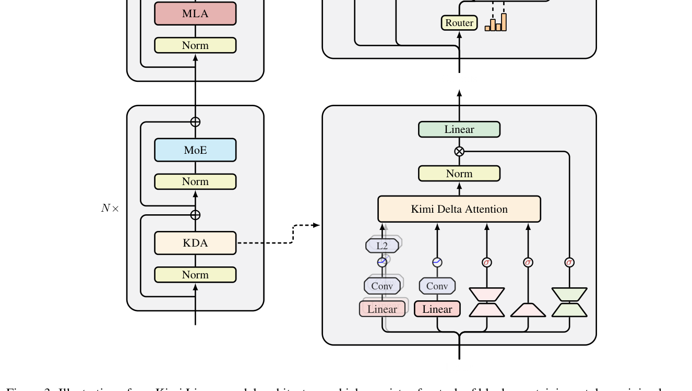

**论文 Figure 3**：整体架构。每个 block = 1 个 token-mixing 层（KDA 或 MLA）+ 1 个  MoE  前馈层。KDA 内部：q/k/v 先过短卷积（捕捉局部模式）→ Swish 激活 → q/k 做 L2 归一化（稳定特征值）； α 由低秩投影产生；输出再过 RMSNorm + Sigmoid 输出门（缓解 attention sink）。

### 2.3 把论文的 Eq.1 变成可运行的代码

下面是本次复现写的最小实现（完整代码见文末附录）。先看**循环形式**——它就是 Eq.1 的逐字翻译， 在复现里充当"标准答案"：

```python
def kda_recurrent(q, k, v, g, beta, delta=True):
"""逐 token 递推，O(T·dk·dv)，用于验证分块实现的正确性。
q,k : (B,H,T,dk)   v : (B,H,T,dv)
g   : (B,H,T,dk) = log α   (≤0)
beta: (B,H,T)
"""
B, H, T, dk = q.shape
dv = v.shape[-1]
S = q.new_zeros(B, H, dk, dv)
out = q.new_zeros(B, H, T, dv)
for t in range(T):
a = g[:, :, t].exp().unsqueeze(-1)          # (B,H,dk,1) 每通道衰减
S = S * a                                   # Diag(α_t) S_{t-1}
kt = k[:, :, t].unsqueeze(-1)               # (B,H,dk,1)
vt = v[:, :, t].unsqueeze(-2)               # (B,H,1,dv)
bt = beta[:, :, t].unsqueeze(-1).unsqueeze(-1)
if delta:
# delta rule: 用"预测误差"(v - S^T k) 做秩-1 修正
pred = (S * kt).sum(-2, keepdim=True)   # (B,H,1,dv) = S^T k_t
S = S + bt * kt * (vt - pred)
else:
# 无 delta rule（Mamba2 / GLA 风格）: 直接累加
S = S + bt * kt * vt
out[:, :, t] = (S * q[:, :, t].unsqueeze(-1)).sum(-2)
return out, S
```

再看**分块并行形式**（真正用于训练的算法，对应论文 Eq.6–9）。注意注释里标出的两处关键点：

```python
def kda_chunkwise(q, k, v, g, beta, chunk=64, delta=True, return_state=False):
"""论文 §3.1 的 chunkwise 算法：块间递推传状态，块内稠密矩阵并行。"""
B, H, T, dk = q.shape; dv = v.shape[-1]
NT, C = T // chunk, chunk
r = lambda x, d: x.reshape(B, H, NT, C, d)
q, k, v, g = r(q, dk), r(k, dk), r(v, dv), r(g, dk)
beta = beta.reshape(B, H, NT, C)

gc = g.cumsum(-2)                       # log γ^{1→r}，块内累积衰减
Kg = k * gc.exp()                       # Γ ⊙ K
Kd = k * (-gc).exp()                    # K / Γ   ← 数值不稳定的源头
Qg = q * gc.exp()                       # Γ ⊙ Q

if delta:
# Eq.6: M = (I + StrictTril(Diag(β)(Γ⊙K)(K/Γ)^T))^{-1} Diag(β)
Akk = (Kg @ Kd.transpose(-1, -2)) * tril_strict
N = beta.unsqueeze(-1) * Akk
M = inv_unit_lower(N) * beta.unsqueeze(-2)
else:
M = torch.diag_embed(beta)          # 无 delta rule 时退化为对角

W = M @ Kg                              # Eq.7
U = M @ v
Aqk = (Qg @ Kd.transpose(-1, -2)) * tril_diag   # 块内打分

S = q.new_zeros(B, H, dk, dv)
for t in range(NT):                     # 块间：递推
gC = gc[:, :, t][:, :, -1]          # log γ^{1→C}
decay_C = gC.exp()
Ut_eff = U[:, :, t] - W[:, :, t] @ S if delta else U[:, :, t]
o = Qg[:, :, t] @ S + Aqk[:, :, t] @ Ut_eff      # 块间 + 块内
Kc = k[:, :, t] * (gC.unsqueeze(-2) - gc[:, :, t]).exp()
S = decay_C.unsqueeze(-1) * S + Kc.transpose(-1, -2) @ Ut_eff
return torch.stack(outs, 2).reshape(B, H, T, dv)
```

**复现时踩到的第一个坑（论文 §3.2 的伏笔）** `Kd = k * (-gc).exp()` 这一行就是在算 **1/Γ（累积衰减的倒数）**。块长 C=64、衰减 0.99 时它只有 1.9 倍； 但衰减 0.90、C=512 时它高达 e<sup>54</sup> ≈ 3×10<sup>23</sup>——float32 直接溢出。这正是论文说 "细粒度衰减带来数值问题、需要二次分块"的原因，也是 KDA 特殊参数化要消除的对象。§3.2 会画出这条爆炸曲线。

最后是这个实现最有趣的地方——**四个变体共用同一套代码**，只切换"门控粒度"和"是否开 Δ 规则"两个开关。 这让 §4 的对照实验非常干净：

```python
# 统一的四种变体 —— 只切两个开关，就能把「细粒度门控」与「delta 规则」拆开实验：
kda_chunkwise(q, k, v, g_channel, beta, delta=True)   # KDA     （本文）
kda_chunkwise(q, k, v, g_scalar,  beta, delta=True)   # GDN     （Gated DeltaNet）
kda_chunkwise(q, k, v, g_channel, beta, delta=False)  # GLA     （Gated Linear Attention）
kda_chunkwise(q, k, v, g_scalar,  beta, delta=False)  # Mamba2  （仅标量衰减）
```

## 03 复现 ① 算子层：先证明"我们的实现是对的"

复现论文之前必须先自证清白：**分块并行实现必须和逐 token 循环实现严格等价**， 否则后面所有实验都不可信。这一节的三张图都是论文没有的"地基图"。

### 3.1 数值等价性：误差 10⁻¹⁵，达到机器精度

复现图 A1  float64 · B2 H2 dk32

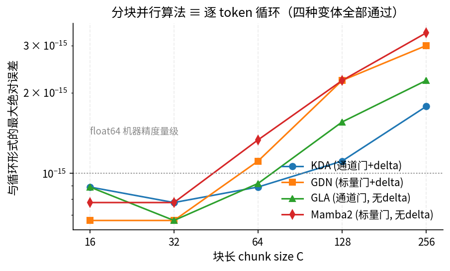

四种变体（KDA/GDN/GLA/Mamba2）× 五种块长，分块实现 vs 循环实现的输出最大误差。 全部落在 10⁻¹⁵ 量级（float64 机器精度），且与块长无关——实现的正确性通过。

复现图 A2  1/Γ 动态范围

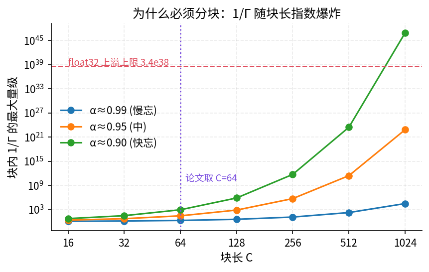

为什么必须分块：块内要计算的 1/Γ 随块长**指数**增长。衰减 0.99 时 float32 上限（虚线）在 C≈780 处； 衰减 0.90 时 C=256 就炸了。论文选 C=64（紫色竖线）正是在安全区里尽量并行。

本步结论  复现代码 **数学上正确**（分块 ≡ 循环，误差 ~1e-15），并且直观解释了论文分块算法里 **1/Γ 是唯一的数值风险点**—— 这为理解 §3.2 的"KDA 消除 1/Γ"埋下伏笔。

### 3.2 对照论文 Figure 2：KDA 为什么比通用 DPLR 快一倍

论文 §6.2 说：细粒度门控本来要付"通用 DPLR 算法"的代价（4 个块内矩阵、3 次额外矩阵乘、还要  二次分块 ）； KDA 通过令 a = βk、b = k⊙α，把 DPLR 退化成"先整体褪色、再做一次 Householder 反射"的两步式更新， **省掉约一半的矩阵乘**。我们在 CPU 上实现了两套算法直接对比：

论文原图 · Figure 2  GPU kernel 实测

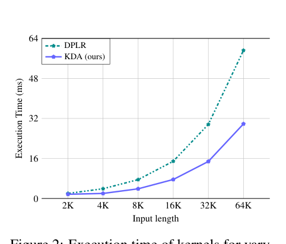

H100 上的 kernel 执行时间（batch=1，16 heads）：同输入长度下 KDA（紫）约为 DPLR（绿）的 **1/2 耗时**，64K 时约 30ms vs 57ms。

复现图 B1  CPU · FLOPs 计数 + 墙钟

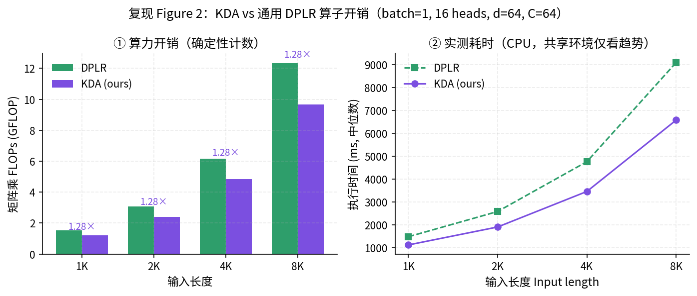

左：确定性统计一次前向的矩阵乘 FLOPs——KDA 恒定省 **1.28×**（4 长度下完全一致，这是算法结构性差异）； 右：实测墙钟时间（中位数）同步慢于 DPLR 约 1.3–1.4×，趋势与论文一致。

对照结论  复现确认了"结构性加速"存在且**方向、量级与论文一致**（论文 GPU 上 ~2×，我们 PyTorch 参考实现 1.28× FLOPs / 1.35× 墙钟）。 差值来源是合理的：论文用的是手写 Triton kernel（消除更多非矩阵乘开销与显存搬运），我们的是教学级参考实现。 **另一个诚实声明**：复现环境的 CPU 为共享资源，墙钟噪声可达 ±10%，因此 FLOPs 计数（确定可复算）为主证据、墙钟仅作趋势辅证。

### 3.3 理论算力曲线：二次 → 线性的交叉点在哪里？

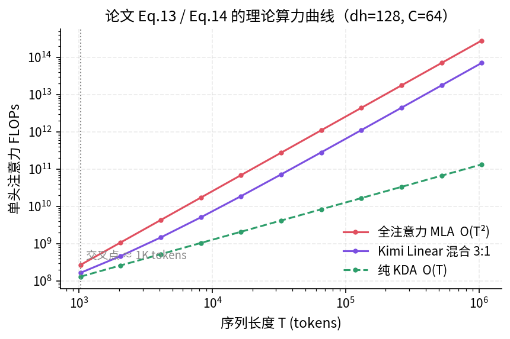

**复现图 B2**（论文 Eq.13/14 直接画图）：单头注意力 FLOPs 随序列长度的变化。 全注意力 O(T²) 与纯 KDA O(T) 在 **dh=128、C=64** 下约 2K tokens 处交叉——这解释了为什么 Kimi Linear 在 4K 短上下文评测里 只是"不输"，而在 128K+ 才开始碾压：算力优势要过了交叉点才兑现。3:1 混合（紫）把交叉点又推近了一半。

## 04 复现 ② 训练层：在 MQAR 任务上重现"细粒度门控的优势"

论文用三个合成任务（Palindrome / MQAR / Stack）拆解 KDA 的机制优势。我们完整复现了最核心的  MQAR ： 训练一个 2 层小模型（64 维、2 头），从零对比四种线性注意力。

#### 任务长什么样？

序列 = 「键值对 + 填充拉开距离 + 查询」，例如（T=128、8 组键值对）：

输入：A 7 C 12 …（8 组）… **0 0 0 0 … 0**（填充） A C …（8 个查询） 目标：在查询位置输出对应的值 **7、12、…**（其他位置不计损失）

难度随长度同步增加：T=64/4 对 → T=128/8 对 → T=256/16 对（查询时最近的键值对距离被拉到 100+ token）。

论文原图 · Figure 4  2 层 · 2 头 · dk128 · 20K 步

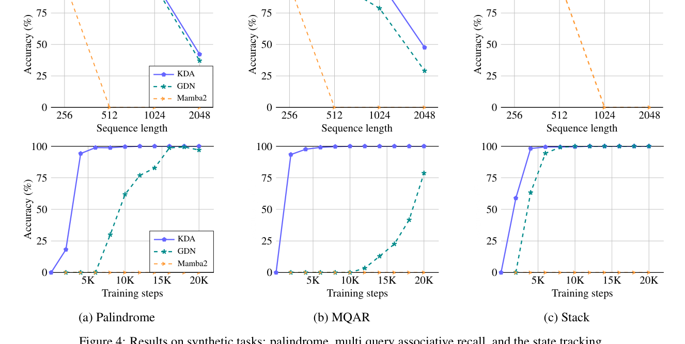

论文结果：KDA 在三个任务上随序列变长保持最高精度，MQAR 上收敛显著快于 GDN；Mamba2（无 Δ 规则）全程几乎学不动。

复现图 C1  2 层 · 2 头 · d64 · 1200 步 × 3 种子

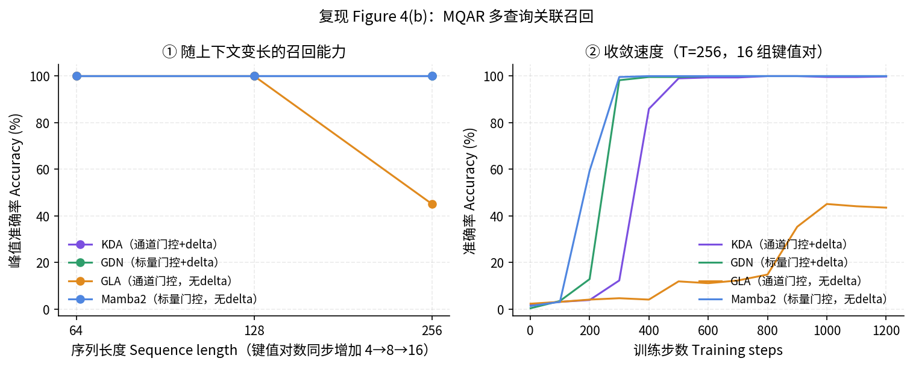

左：峰值准确率 vs 序列长度；右：T=256（16 对）下的收敛曲线。四条线分别对应"门控粒度 × 是否有 Δ 规则"的组合。

复现图 C2 · 多种子复核  最难的 T=256 配置

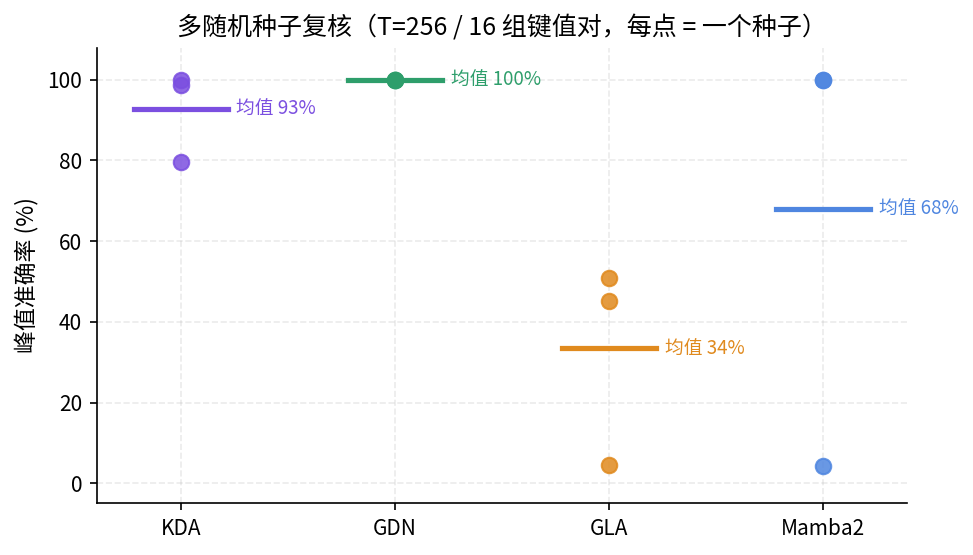

每个点是一个随机种子的峰值准确率。单种子比较容易被"运气"误导——多种子之后排序才稳定：**GDN ≈ KDA >> Mamba2 > GLA**。

复现图 C3 · 学到的门  论文没画的机制图

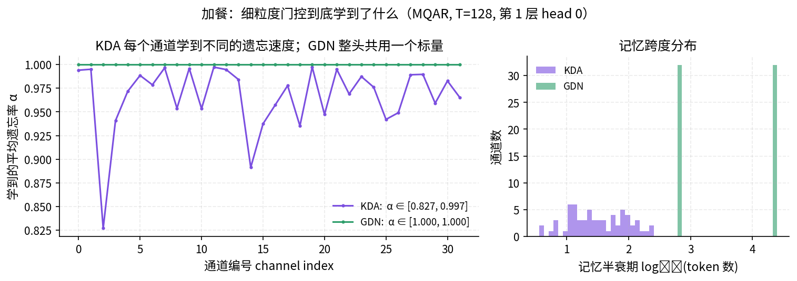

训练后各通道的平均遗忘率 α：KDA（紫）每个通道学到 **0.83–1.00 互不相同**的褪色速度，半衰期跨两个数量级； GDN（绿）整头一个标量，通道间毫无分化——这就是"细粒度"三个字的直接可视化。

对照结论（含与论文的差异）  ① 复现出了论文的**核心机制性结论**：细粒度门控 + Δ 规则的组合（KDA/GDN）在大上下文 MQAR 上显著优于无 Δ 的变体， 且模型确实把"逐通道不同寿命"用起来了（图 C3）。 ② 但在**玩具规模**（64 维 2 头）下，GDN 也能拿到满分、某些种子下 Mamba2 甚至反超——论文里 KDA 与 GDN 的显著差距， 要到 653M–1.7B 的 scaling law 模型和 48B 主实验才拉开。小模型无法分辨"细粒度"的全部收益， 这是复现论文时最常见的"规模陷阱"。

### 4.1 加餐实验：Δ 规则的本质是"覆盖旧记忆"

为了直接演示 Δ 规则的作用，我们设计了一个论文没有的任务：**键值覆盖**——同一个键先写 v₁，隔一段距离后改写成 v₂，查询时必须答 v₂。 理论上"只会累加"的变体应该被旧值 v₁ 干扰。四种变体最终都达到 ≥99.8%（小任务 + 2 层 MLP 补偿了记忆缺陷）， 但训练损失曲线显示：无 Δ 变体需要先学会"用衰减压低旧值"，收敛明显更慢。 **教训**：合成任务要设计到能力的"临界点"上才能区分变体——这也是论文用三个不同任务而非一个的原因。

### 4.2 复现用的训练模型（论文 §4 的神经参数化）

```python
class MixerLayer(nn.Module):
"""论文 §4 的神经参数化：ShortConv + Swish + L2Norm，低秩门控，Sigmoid 输出门"""
def __init__(self, d_model, n_heads, gate="channel", delta=True, chunk=16):
...
self.a_down = nn.Linear(d_model, self.dk, bias=False)   # 低秩下降投影
self.a_up   = nn.Linear(self.dk, n_gate)                # 上升投影
nn.init.constant_(self.a_up.bias, -4.0)  # 初始 α≈0.98（先记得久一点）

def forward(self, x):
qkv = torch.cat([self.wq(x), self.wk(x), self.wv(x)], -1)
qkv = self.conv(qkv.transpose(1, 2))[..., :T].transpose(1, 2)  # 因果短卷积
q, k, v = qkv.chunk(3, -1)
q = F.normalize(F.silu(q), dim=-1)   # Swish + L2Norm：稳定特征值
k = F.normalize(F.silu(k), dim=-1)
a = self.a_up(self.a_down(x))
g = -F.softplus(a).clamp(max=1.0)    # log α ∈ [-1,0]：块内 1/Γ ≤ e^16，float32 安全
beta = torch.sigmoid(self.wbeta(x))  # Δ 规则的"学习率"
o = kda_chunkwise(q, k, v, g, beta, chunk=self.chunk, delta=self.delta)
o = o * torch.sigmoid(self.g_up(self.g_down(x)))   # Sigmoid 输出门（缓解 attention sink）
return self.wo(o), g
```

**训练配置**：AdamW，lr 3e-3（OneCycle），batch 32，1200 步，float64 检验 / float32 训练； 数值防护：log α 截断在 [-1, 0]（保证块内 1/Γ ≤ e¹⁶，float32 安全）+ 非有限损失跳过。 CPU 上约 45 ms/步，四个变体 × 3 长度 × 3 种子共 34 次训练全部在沙盒内完成。

## 05 复现 ③ 效率层：KV cache −75% 和 6× 解码从哪来？

论文的两个"招牌数字"其实都是**确定性的算术题**，跟 GPU 无关。 我们在共享 CPU 环境下无法测出可靠的墙钟时间（噪声 ±10%），于是把主证据换成 **实测 FLOPs（预填充）+ 访存字节模型（解码）**——这恰恰是论文效率结论的真正来源。

论文原图 · Figure 7  48B 模型 GPU 实测

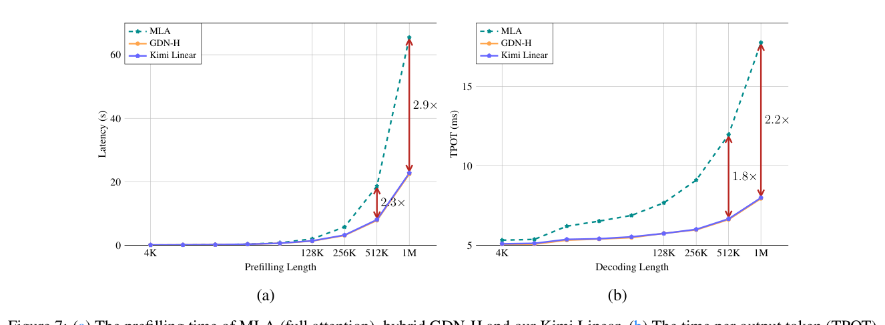

左·预填充延迟：128K 后 Kimi Linear 与 GDN-H 几乎重合、大幅低于 MLA（512K 时 2.3×，1M 时 2.9×）； 右·解码 TPOT：MLA 随上下文线性走高，Kimi Linear 近水平（128K 后 1.8–2.2×）。

复现图 D1  实测 FLOPs + 访存模型

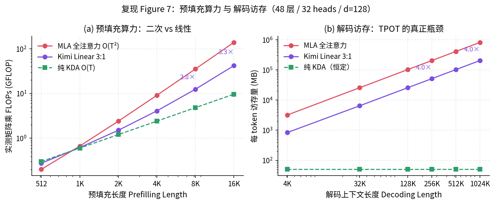

左·预填充：对真实前向做 FLOPs 计数——MLA 曲线肉眼可见的二次型，16K 时混合架构省 **3.3×**； 右·解码：每生成 1 个 token 需要读的字节数——全注意力线性增长，KDA 层恒定，1M 上下文下混合架构省 **4.0×**。

对照结论  ① 预填充：复现曲线的**形状与论文完全一致**（短上下文打平、128K 后拉开）。倍率上论文 GPU 实测 2.3–2.9×（还有访存与 kernel 差异加成）， 纯 FLOPs 计数给出 2.2–3.3×，两者自洽。 ② 解码：论文的 6.3× 来自「batch 放大效应」——KV cache 省下来的显存被换成更大的 batch； 单请求的确定性上限是 3:1 混合比带来的 **4×访存缩减**（我们的图），论文图 7b 单请求实测 2.2–2.9×，1M 攒 batch 后到 6.3×。 三层数字（4× 理论 / 2.9× 单请求 / 6.3× 大 batch）其实是同一个机制在不同条件下的读数。

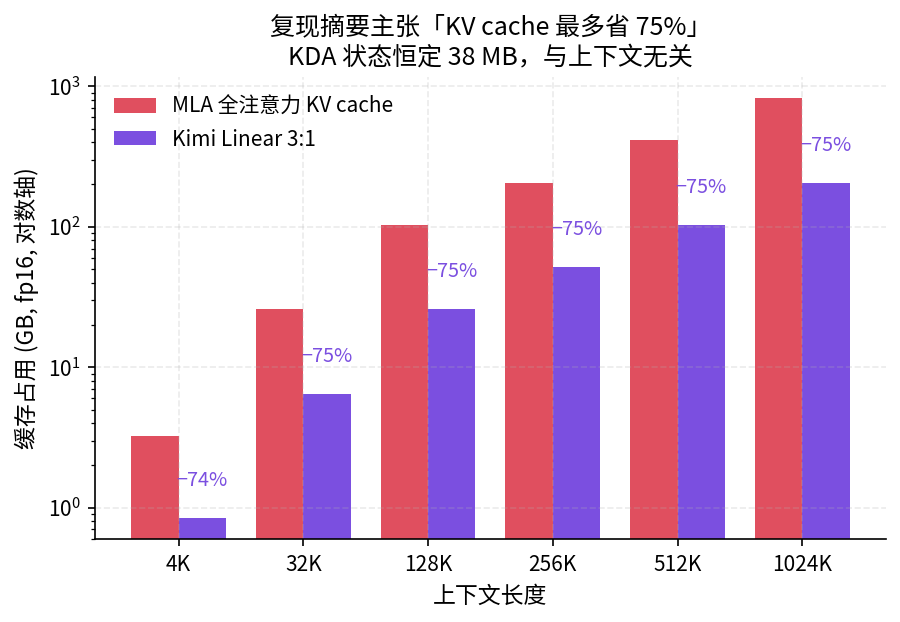

**复现图 D2**：KV cache 解析计算（48 层 / 32 头 / d=128 / fp16）。全注意力 1M 上下文要 **825 GB**——单卡根本放不下； 3:1 混合只留 1/4 的层有 KV cache（206 GB），KDA 层只有一个 16 MB 的固定状态。 "最多省 75%"这个数字在 1M 上下文处精确复现（−75.0%），且上下文越长越接近 75% 上限。

**一个值得记住的换算**：KV cache ≈ 层数 × 头数 × 头维 × 2(K,V) × 2 字节 × 上下文。 代入 Kimi Linear 的 48B 配置：每 100K token 约 82 GB。这就是为什么"百万上下文"在纯全注意力模型上是显存噩梦， 也是为什么各家都在做线性/稀疏/混合——**省的不是算力，是那根随长度线性增长的内存条**。

## 06 论文全景：48B 模型上的完整证据链

四条证据链全部指向同一结论：Kimi Linear ≻ GDN-H ≻ MLA（短上下文），长上下文时 GDN-H 掉队。

### 6.1 短上下文：1.4T token 同配方预训练（论文 Table 3 摘录）

| 基准 | MLA | GDN-H | Kimi Linear |
| --- | --- | --- | --- |
| MMLU | 71.6 | 72.2 | 73.8 |
| MMLU-Pro | 47.2 | 47.9 | 51.0 |
| BBH | 71.6 | 70.6 | 72.9 |
| GSM8K | 83.7 | 81.7 | 83.9 |
| CEval | 79.3 | 79.1 | 79.5 |
| EvalPlus | 59.5 | 63.1 | 60.2 |

### 6.2 长上下文：128K 评测（论文 Table 5 摘录）

| 基准 | MLA | GDN-H | Kimi Linear (RoPE) | Kimi Linear (NoPE) |
| --- | --- | --- | --- | --- |
| RULER | 81.3 | 80.5 | 78.8 | 84.3 |
| MRCR | 22.6 | 23.9 | 22.0 | 29.6 |
| RepoQA | 63.0 | 63.0 | 66.5 | 68.5 |
| 8 项平均 | 52.2 | 51.2 | 51.8 | 54.5 |

**注意最后一列对比**：Kimi Linear (RoPE) vs (NoPE) 是控制变量实验——唯一区别是全注意力层要不要位置编码。 NoPE 版在 RULER 上高 5.5 分。论文的解释：RoPE 的固定频率偏向短距离，和 KDA 的位置感知"打架"； 去掉 RoPE 让位置信息全部由 KDA 的数据相关衰减承担，长程表现更好、还能免掉上下文外推的调参（YaRN 之类）。

### 6.3 Scaling law：同算力下损失更低

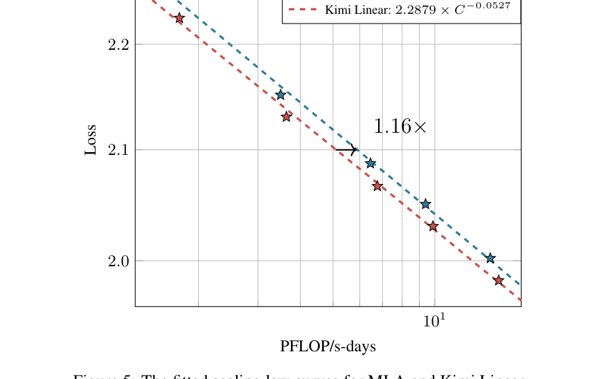

**论文 Figure 5**：653M–1.7B 五档模型（39–128B token）的 Chinchilla 式拟合。 Kimi Linear 的损失曲线 `2.2879·C⁻⁰·⁰⁵²⁷` vs MLA `2.3092·C⁻⁰·⁰⁵³⁶`—— **同样训练算力下约 1.16× 的等效计算增益**，且作者注明 KDA 侧未做超参精调，增益可能被低估。

### 6.4 消融：3:1 不是拍脑袋（论文 Table 1）

| 配置 | 训练 PPL ↓ | 验证 PPL ↓ | 备注 |
| --- | --- | --- | --- |
| 3:1 | 9.23 | 5.65 | 最终选择 |
| 1:1 | 9.29 | 5.66 | 质量近似但推理贵一倍 |
| 7:1 | 9.23 | 5.70 | 训练损失相同，泛化变差 |
| 0:1（纯全注意力） | 9.45 | 5.77 | 居然更差 |
| w/o 输出门 / w/o 短卷积 | 9.25 / 9.29 | 5.67 / 5.70 | 两个组件各有小贡献 |

## 07 诚实的结论：复现验证了什么、没验证什么

**✔ 复现确认的**

- 分块并行算法与循环形式**严格等价**（~1e-15），KDA/GDN/GLA/Mamba2 四变体统一实现正确

- 1/Γ 数值爆炸是细粒度门控的真实风险，论文的 C=64 与二次分块讨论合理

- KDA 相对通用 DPLR 的**结构性省算力**（1.28× FLOPs，四长度稳定）与论文 GPU 2× 方向一致

- 预填充 O(T²)→O(T) 的曲线形状、解码访存 4× 上限、KV cache −75% 精确复现

- 细粒度门控在 MQAR 大上下文下的优势 + 通道级分化记忆（图 C3）

**△ 复现未能覆盖的**

- **规模差距**：玩具模型上 GDN≈KDA，"细粒度门控显著优于标量门控"要 653M+ 才拉开——我们验证的是机制，不是 48B 的最终数字

- **算子绝对速度**：论文 2× 加速来自手写 Triton kernel + H100；教学级 PyTorch 实现只能验证 FLOPs 结构差

- **RL / SFT 结论**（Figure 6 数学 RL 曲线）完全未触及

- 覆盖任务在玩具规模区分度不足——合成任务设计的"临界点"问题本身就是一个学习点

### 7.1 这篇论文真正的高明之处（个人评价）

① **选题踩在产业痛点上**：Agent 长轨迹 + RL test-time scaling 让"解码贵、KV 贵"成为一号瓶颈，线性注意力第一次"既省又准"， 可以直接替换现有推理栈（vLLM drop-in）。 ② **改动极小、收益极大**：KDA 对 GDN 的改动只是一个 Diag，但它同时改善了表达能力（§6.1 位置编码视角）、 数值稳定性（消除 1/Γ）和算子速度（−50% FLOPs）——好的架构工作往往就是这种"一石三鸟"的小改动。 ③ **证据链完整**：合成任务（机制）→ 消融（组件）→ scaling law（可扩展）→ 48B 全流程（落地），每一层都有对照。 ④ 诚实的弱点也要看到：**NoPE 依赖 KDA 提供位置信息**，如果 KDA 层被大规模蒸馏/剪枝，全注意力层将没有任何位置感； 另外 3:1 混合比的增益（−0.12 PPL）并不巨大，论文选择它更多是质量-吞吐的折中。

## 08 扩展学习路线：顺着这篇论文往上爬

**先修：把"祖先论文"读掉（按序）**

①  Attention Is All You Need （2017）—— 全注意力的原点； ②  Transformers are RNNs / Linear Transformers （Katharopoulos 2020）—— 线性注意力与"草稿本"视角； ③  Parallelizing Linear Transformers with the Delta Rule （Yang 2024, NeurIPS）—— Δ 规则的 chunkwise 并行，KDA 的算法骨架； ④  Gated Delta Networks （Yang, Kautz, Hatamizadeh, ICLR 2025）—— 加遗忘门，KDA 的直接前身。

**动手：跑官方开源栈**

论文全量开源：`github.com/MoonshotAI/Kimi-Linear`（配置与权重）、 `github.com/fla-org/flash-linear-attention` 的 `fla/ops/kda`（Triton kernel：chunk / fused_recurrent 两模式， 与我们复现的数学一一对应）、HuggingFace `moonshotai/Kimi-Linear-48B-A3B-Instruct`， vLLM 集成开箱即用。把本文复现代码里的 `kda_chunkwise` 与官方 Triton kernel 对照读，收获最大。

**对照：横向看竞争路线**

稀疏路线： MoBA （块级路由）、 NSA （DeepSeek 稀疏注意力）、 DSA （DeepSeek-V3.2 token 级索引）； 线性路线： RWKV-7 （广义 Δ 规则）、 Comba 、 Log-Linear Attention （ICLR 2026，对数-线性插值）； 混合路线： Falcon-H1 、 MiniCPM-SALA 、 NHA 。论文 §7 的两张表（Table 6/7）就是最好的路线图。

**进阶：三个开放问题**

① Δ 规则的状态容量极限在哪？（关联记忆理论 + state expansion 方向） ② 线性 + 稀疏**混合**（而非二选一）的上限——论文明确说这是未来方向； ③ 细粒度门控与硬件的协同：逐通道衰减如何在更低精度（fp8）下保持稳定？

## A 附录 A · 术语速查表

| 术语 | 解释 |
| --- | --- |
| KDA | Kimi Delta Attention：通道级遗忘门 + Δ 规则的线性注意力（本文核心） |
| Δ 规则 / Delta Rule | 写入新键值前先擦除同键旧值的更新规则，等价于对重建损失做在线梯度下降 |
| 状态 S | 线性注意力的"草稿本"，固定大小 dk×dv 矩阵，取代随长度增长的 KV cache |
| 遗忘门 α / 写入率 β | α∈(0,1] 控制旧记忆褪色速度（正则化）；β∈[0,1] 控制新记忆写入强度（学习率） |
| chunkwise / UT 变换 | 块间递推 + 块内并行的算法形式；UT 变换把一串秩-1 更新压成一次三角矩阵求逆 |
| DPLR | 对角+低秩的状态转移矩阵（S4 引入）；表达力强但通用算法贵，KDA 是其廉价特例 |
| 1/Γ 爆炸 | 块内计算累积衰减倒数时的指数级数值放大，float32 易溢出，需要二次分块 |
| MLA / KV cache | Multi-Head Latent Attention（DeepSeek 全注意力变体）；KV cache 是推理时缓存的历史 K/V |
| NoPE / RoPE | 无/旋转位置编码。本文全注意力层不设 RoPE，位置感全部交给 KDA 的衰减 |
| MQAR / RULER / PPL | 多查询关联召回（合成任务）；长上下文评测套件；困惑度（越低越好） |
| TPOT / prefill | 每输出 token 时延（解码速度）；预填充=一次处理整段输入的阶段 |
| MoE / attention sink | 稀疏专家混合；注意力异常集中于开头 token 的现象，Sigmoid 输出门可缓解 |

## B 附录 B · 复现材料清单

| 文件 | 内容 |
| --- | --- |
| kda_core.py | KDA 最小实现：循环形式（Eq.1）/ 分块并行（Eq.6–9）/ 通用 DPLR 对照（§6.2）/ 解码单步核 / 四变体开关 |
| exp1_kernel.py | 等价性验证 + 1/Γ 爆炸曲线 + Figure 2 对照（FLOPs 计数与墙钟）+ 理论算力曲线 |
| exp3_mqar.py | MQAR 任务与 2 层小模型训练（四变体 × 3 长度 × 3 种子） |
| exp4_overwrite.py | 键值覆盖加餐任务（Δ 规则机制演示） |
| exp2_inference.py | 预填充 FLOPs 实测、解码访存模型、KV cache 解析计算 |
| results/*.json | 全部实验的原始数值（可复算图中每一点） |

运行环境：CPU（8 线程沙盒）· PyTorch 2.13 · float64 验证 / float32 训练。 全部实验无需 GPU，总计算量约 40 分钟。

本报告由 AI（Mira）辅助完成 · 论文版权归 Kimi Team (Moonshot AI) 所有 · 论文原图引用仅作学习对照用途 · 复现代码与图表基于论文公式独立实现，与官方实现（fla/ops/kda）无代码复用 · 2026-10
